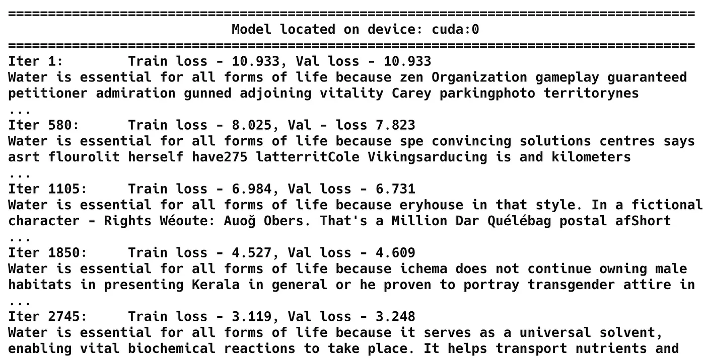
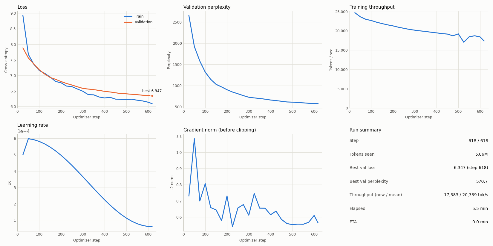

# GPT-Style Language Model from Scratch



This project trains a GPT-2-style large language model (LLM) from scratch, so you can explore how modern LLMs are built and trained. By experimenting with smaller or larger models, and with a small (public-domain novel) or large (English Wikipedia) dataset, you can see the inner workings and trade-offs involved in training such models.

## Key Features

- **One training entry point:** `train.py` trains on *Alice in Wonderland* (quick local runs) or English Wikipedia (~6.4M articles, via Hugging Face), driven by one YAML file.
- **Fast, long-context training:** fused attention kernels (flash / memory-efficient), mixed precision (bf16 or fp16, picked automatically), fused AdamW, gradient accumulation, optional gradient checkpointing and `torch.compile`.
- **Live metrics:** train/validation loss, perplexity, learning rate, gradient norm, tokens/sec, elapsed time and ETA. They go to the console, `train.log` and `metrics.csv`, and a dashboard plot (`training.png`) is redrawn at every evaluation, so you can watch a run while it trains.
- **Safe, resumable long runs:** the best checkpoint (by validation loss) is saved as training goes, and a resumable `last.pt` is saved regularly and on exit or Ctrl+C. Optional early stopping ends a run once validation loss stops improving.
- **Text generation:** greedy, temperature / top-k / top-p sampling, repetition penalty, no-repeat n-grams, and beam search.
- **Model sizes:** configs for ~96M, 124M (GPT-2 small) and ~355M (GPT-2 medium) parameter models.
- **Device flexibility:** runs on `cuda`, `mps` or `cpu`, picking the best available by default.

## Project Layout

```
train.py                   # training entry point
generate.py                # text generation from a checkpoint
configs/                   # config.py (typed settings) + YAML configs
data/                      # corpus.py (download/clean), dataset.py (tokenise, sliding windows)
models/gpt2_model.py       # the GPT model
text_generation/           # decoding strategies
training/trainer.py        # training loop, evaluation, checkpoints, early stopping
utils/                     # checkpoints, logging/device/seed helpers, plotting
tests/                     # pytest suite (runs on CPU in seconds)
```

## Setup

1. **Install Miniconda (recommended):** [Miniconda Installation Guide](https://docs.conda.io/en/latest/miniconda.html)

2. **Create and activate the environment:**
   ```
   conda create -n my_LLM python=3.10.15
   conda activate my_LLM
   pip install -r requirements.txt
   ```
   For GPU training, install the CUDA build of PyTorch that matches your driver (see [pytorch.org](https://pytorch.org/get-started/locally/)).

3. **Hugging Face login (only for Wikipedia):**
   ```
   huggingface-cli login
   ```
   The first Wikipedia run downloads the dataset (~11 GB) into the Hugging Face cache.

## Training

Run all commands from the repository root.

- **Small dataset (*Alice in Wonderland*):** good for quick local tests.
    ```
    python train.py --config configs/gpt2_133m_config.yaml --data alice
    ```

- **Large dataset (English Wikipedia):** GPU recommended.
    ```
    python train.py --config configs/gpt2_162m_config.yaml
    ```

Each run writes to `outputs/<config>_<data>_<timestamp>/`:

| File | Contents |
|---|---|
| `best.pt` | checkpoint with the lowest validation loss |
| `last.pt` | resumable checkpoint (weights + optimizer state), saved every `save_interval` steps, at the end and on Ctrl+C |
| `metrics.csv` | one row per evaluation: step, epoch, tokens, train/val loss, val perplexity, lr, grad norm, tokens/sec, elapsed and ETA (minutes) |
| `training.png` | dashboard of loss, validation perplexity, tokens/sec, learning rate, gradient norm and a run summary, redrawn at every evaluation |
| `samples.csv` | text generated from the configured prompt every `sample_interval` steps |
| `train.log` | the full console log |
| `config.yaml` | the exact settings used |

### Watching a run

Every evaluation prints a status line, appends a row to `metrics.csv` and redraws `training.png`. Open the PNG in any image viewer (VS Code refreshes it as it changes) to follow a run live:

```
Epoch 1 step 300/618 | train 6.491 | val 6.583 (ppl 722.8) | lr 3.66e-04 | grad norm 0.61 | 20,174 tok/s | elapsed 2.5 min, ETA 2.6 min
```



*A 5.5-minute run of the 133M config (~96M parameters, 512-token context) on 0.01% of Wikipedia (3.2M tokens, 2 epochs) on a Quadro RTX 5000 laptop GPU. Throughput averaged 20.3k tokens/sec; it started at ~25k and fell as the laptop GPU heated up (thermal throttling).*

Text generated during that run from the prompt *"Water is essential for all forms of life because"* (`samples.csv`). It goes from word salad toward grammatical, encyclopedic phrasing as validation loss falls:

| Step | Tokens seen | Val loss | Generated text |
|---|---|---|---|
| 200 | 1.6M | 6.80 | Water is essential for all forms of life because that a non. In the same other common to be the example, but it or well as the work and many than his |
| 400 | 3.3M | 6.49 | Water is essential for all forms of life because the right. As by a single and more other, or more than if there has been on any very closely to an |
| 600 | 4.9M | 6.36 | Water is essential for all forms of life because up to the other in the two or as an electron. The case of least and thus, when a common number with its |
| 618 (final) | 5.1M | 6.35 | Water is essential for all forms of life because. This was not been developed from the law and others, including the time to be considered that they have only as a general |

These come from a deliberately tiny demo run. Train on more data (a larger `subset_ratio`) and for longer to get coherent text.

### Resuming

```
python train.py --resume outputs/<run>/last.pt
```

Training continues in the same run directory with the same settings, on exactly the batches it would have seen without the interruption. To change settings (for example to train for more epochs), also pass `--config new_settings.yaml`. Note that changing `num_epochs` recalculates the learning-rate schedule.

Tokenised corpora are cached in `corpuses/*.npy`, so later runs skip tokenisation.

VS Code users can use the launch configurations in `.vscode/launch.json`.

## Generating Text

```
python generate.py --checkpoint outputs/<run>/best.pt --config configs/gpt2_133m_config.yaml --prompt "Once upon a time"
```

Decoding settings come from the `generation` section of the config. Checkpoints written by the earlier version of this project also load.

## Configuration

Every key is optional (defaults live in [configs/config.py](configs/config.py)), and a misspelled key is reported as an error. Floats need a decimal point (`6.0e-4`, not `6e-4`). The 162M config as an example:

```yaml
run:
  output_dir: outputs
  device: null            # cpu, mps or cuda; null = best available
  seed: 42

data:
  source: wikipedia       # alice | wikipedia (or use --data)
  subset_ratio: 0.001     # fraction of Wikipedia articles to use
  val_ratio: 0.2
  stride: null            # training window stride; null = context_length (no overlap)

training:
  num_epochs: 20
  batch_size: 8
  grad_accum_steps: 4     # effective batch = 8 x 4 sequences of 1024 tokens
  learning_rate: 6.0e-4   # peak, after linear warmup
  min_lr: 6.0e-5          # end of cosine decay
  warmup_ratio: 0.05
  weight_decay: 0.1
  grad_clip: 1.0
  precision: auto         # auto | fp32 | fp16 | bf16
  compile: false          # torch.compile (needs Triton: Linux + CUDA)
  grad_checkpointing: false
  eval_interval: 50       # optimizer steps between evaluations
  eval_batches: 20
  early_stopping_patience: 5   # 0 = off
  sample_interval: 250
  save_interval: 500      # steps between resumable last.pt saves

generation:
  prompt: "Water is essential for all forms of life because"
  max_new_tokens: 25
  temperature: 1.0
  top_k: 50
  top_p: 0.9
  repetition_penalty: 1.5
  no_repeat_ngram_size: 3
  num_beams: 1            # > 1 = beam search
  do_sample: true         # false = greedy

model:
  vocab_size: 50257
  context_length: 1024
  emb_dim: 768
  n_heads: 12
  n_layers: 12
  drop_rate: 0.1
  qkv_bias: false
  tie_weights: true       # share input embedding and output head (as GPT-2 does)
```

### Training on longer contexts

- Attention uses PyTorch's fused kernels, so memory grows linearly with context length, not quadratically.
- If you run out of memory, lower `batch_size` and raise `grad_accum_steps` to keep the same effective batch.
- `grad_checkpointing: true` cuts activation memory a lot for ~20% extra compute. It lets a 124M model train at 2048 tokens in under 6 GiB.

## Results and Performance

Training throughput for the 124M/162M model on one Quadro RTX 5000 (16 GB, Turing, fp16 autocast), before and after the refactor:

| Context × batch | Before | After |
|---|---|---|
| 256 × 8 | 5.2k tok/s, 6.2 GiB | 17.4k tok/s, 3.3 GiB |
| 1024 × 4 | 4.3k tok/s, 13.9 GiB | 18.4k tok/s, 4.9 GiB |
| 2048 × 4 | out of memory | 14.0k tok/s, 5.7 GiB (gradient checkpointing) |

Earlier timings with the original code (162M model, MacBook Pro M2 32 GB for CPU/MPS, single A100 for GPU):

- *Alice in Wonderland*: CPU ~3.96 min, MPS ~1.68 min, GPU ~0.27 min (batch 8), ~0.22 min (batch 32).
- Wikipedia (0.01% subset): CPU ~6.94 min, MPS ~2.41 min, GPU ~0.46 min (batch 8), ~0.4 min (batch 32).

Even a small fraction of Wikipedia produces far more coherent text than training only on a small book.

## Tips

- **More data beats more epochs:** if validation loss rises while training loss falls, the model is overfitting. Use a larger `subset_ratio` or turn on `early_stopping_patience`.
- **Smaller model + more data** often produces more coherent results than a larger model trained on very little data.
- **Compare runs** with `metrics.csv`. Validation perplexity (`val_ppl`) is the easiest number to compare.

## Tests

```
pytest
```

## Further Reading

For more background, see the [LLMs-from-scratch GitHub repository](https://github.com/rasbt/LLMs-from-scratch).

## Contributors

- [Wajih Ullah Baig](https://github.com/wajihullahbaig): author
- Claude (Anthropic's AI model, via Claude Code): code review and refactor, including bug fixes, faster long-context training, metrics, checkpointing, early stopping and tests
